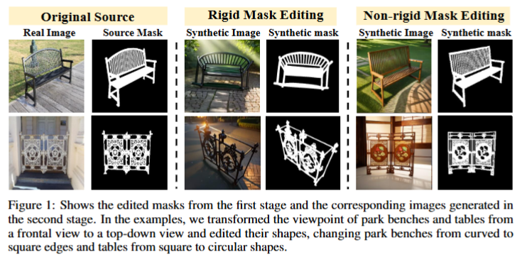
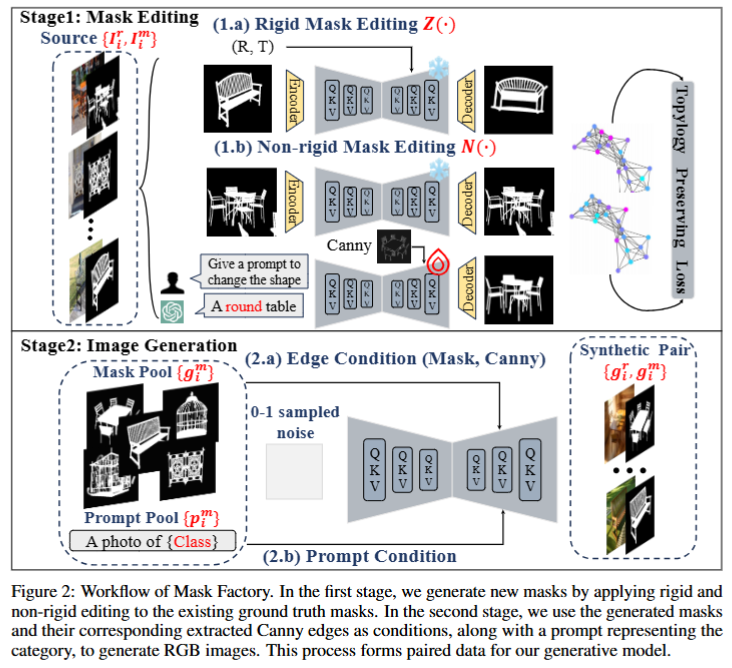

# MaskFactory-Jittor

Jittor migration of **MaskFactory: Towards High-quality Synthetic Data Generation for Dichotomous Image Segmentation**.

[中文](README.md) · [Original implementation](https://github.com/ydchen0806/MaskFactory)

This is a community migration. Figures below come from the upstream project, not new migration experiments. Model weights are not included.

This repository keeps the original MaskFactory layout and ports the main PyTorch execution paths to Jittor with minimal structural changes. The current focus is inference, editing, and parity verification for the original components: SD1.5, ControlNet, Multi-ControlNet, Zero123, MasaCtrl, and SDXL.

Original paper: [NeurIPS 2024](https://proceedings.neurips.cc/paper_files/paper/2024/file/7aad0cdc7e140778ad944f17a266e1bc-Paper-Conference.pdf) / [arXiv](https://arxiv.org/pdf/2412.19080)




## What Is Included

- Jittor-native SD1.5 inference and MasaCtrl editing.
- Jittor ControlNet and Multi-ControlNet execution.
- Jittor Zero123 novel-view inference.
- Jittor SDXL inference with the original `run_synthesis_sdxl.py` entry.
- PyTorch/Jittor parity tests for core modules.
- Structure audit to check that the migrated repository still matches the original file and symbol layout.

## Repository Layout

```text
.
├── infer.py                      # SD1.5/MasaCtrl inference entry
├── train.py                      # Original training skeleton migrated to Jittor
├── parrellel_diffusion.py         # Batch editing entry, path-adjusted for this repo
├── run_synthesis_sdxl.py          # SDXL MasaCtrl synthesis entry
├── masactrl/                     # Jittor MasaCtrl, SD1.5, ControlNet utilities
├── sdxl/                         # Jittor SDXL implementation
├── zero123/                      # Zero123 code with Jittor inference/model files
├── tests/                        # Structure, smoke, and parity checks
├── tools/                        # Weight conversion helpers
└── docs/                         # Migration notes and validation status
```

## Environment

The validated server environment uses:

- Python 3.10
- Jittor 1.3.11
- CUDA 12.2 Jittor CUDA bundle
- H100 MIG runtime for the current checks

On the validation server:

```bash
source env_maskfactory_jittor.sh
```

For a new machine, install the packages in `requirements.txt`, prepare a working Jittor CUDA environment, and place model weights under a model root such as:

```text
models/
├── stable-diffusion-v1-5/
├── stable-diffusion-xl-base-1.0/
├── sd-controlnet-canny/
├── sd-controlnet-seg/
└── zero123/
    ├── jittor/
    └── jittor_ema/
```

On a new machine, set `MASKFACTORY_ROOT="$PWD"` and `MASKFACTORY_MODELS="$PWD/models"` from the repository root. The environment script above is specific to the original validation server and overwrites those variables; do not source it unchanged on another machine. Pass explicit model and output paths to parity scripts; see the portable commands in [README.md](README.md).

## Quick Checks

Run the structural audit:

```bash
python tests/audit_structure.py ../MaskFactory .
```

Run SD1.5 parity:

```bash
bash tests/run_parity.sh
```

Run Zero123 parity:

```bash
python -m tests.parity_zero123 torch
python -m tests.parity_zero123 jittor
python -m tests.parity_zero123 compare
```

Run ControlNet parity:

```bash
python -m tests.parity_control torch --model /path/to/sd-controlnet-canny --work tests/output/control
python -m tests.parity_control jittor --model /path/to/sd-controlnet-canny --work tests/output/control
python -m tests.parity_control compare --model /path/to/sd-controlnet-canny --work tests/output/control
```

Run Multi-ControlNet smoke test:

```bash
python -m tests.smoke_multi \
  --base /path/to/stable-diffusion-v1-5 \
  --canny /path/to/sd-controlnet-canny \
  --seg /path/to/sd-controlnet-seg \
  --output tests/output/multi.png
```

Run SDXL synthesis:

```bash
python run_synthesis_sdxl.py
```

## Current Validation Status

See [docs/MIGRATION_STATUS.md](docs/MIGRATION_STATUS.md).

Short version:

- SD1.5 parity: passed.
- Zero123 parity: passed.
- ControlNet parity: passed.
- Multi-ControlNet smoke: passed.
- SDXL original 1024x1024 synthesis entry: passed.
- Structure audit: passed.

## Notes

- The original `train.py` contains a placeholder dataset in the upstream code. The Jittor migration keeps that structure; full real-data training is not claimed here.
- `run_8_node.sh` has been path-adjusted, but true 8-GPU execution was not validated on the current H100 MIG server.
- The archived SDXL report has `output_passed=true` but `passed=false`: the second-step `noise1` relative RMSE is 0.020902 against a 0.003 limit. Full intermediate parity has not passed.
- Original Zero123 auxiliary training and 3D-reconstruction code is retained and may still use PyTorch. The migrated novel-view entry is `zero123.zero123.jittor_infer`.
- Archived numerical reports are available in [docs/validation/](docs/validation/). The release checks did not rerun all GPU inference workloads.

## Acknowledgements

This repository is based on MaskFactory and includes Zero123-derived code. Please cite and respect the original projects and papers when using this migration.

## License

Third-party code retains its original copyright and license files. The upstream MaskFactory snapshot has no top-level license, so this release does not assign a new blanket license to the combined repository. Use and redistribution remain subject to the respective upstream permissions.
